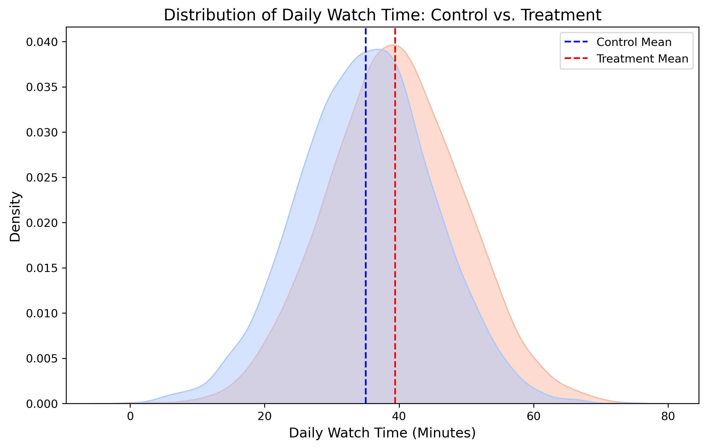

# Streaming Platform A/B Testing Project

## Project Overview
This project simulates and analyzes an A/B test for a media streaming platform like Netflix or YouTube. The goal of the experiment is to determine whether a newly designed Personalized Recommendation Row on the homepage increases user engagement compared to the current generic "Trending Now" Grid.

## Business Problem
* Control Group (Variant A): Current homepage layout with a generic Trending Now grid.
* Treatment Group (Variant B): Redesigned homepage layout with a personalized video recommendation row at the top.
* Primary Metric: Average daily watch time per user measured in minutes.

## Hypotheses Formulation
* Null Hypothesis (H0): The personalized layout has no effect on average daily watch time.
* Alternative Hypothesis (H1): The personalized layout increases average daily watch time.

## Tech Stack and Libraries
* Language: Python
* Environment: Jupyter Notebook
* Libraries Used: NumPy, Pandas, Matplotlib, Seaborn, and SciPy.

## Methodology and Findings

### 1. Data Generation and EDA
A synthetic dataset representing 10,000 unique users was generated using normal distributions to mirror realistic user engagement patterns. The data was split evenly with a 50/50 ratio between the Control and Treatment groups.

Here is the distribution of user watch times captured during the experiment:

### 2. Hypothesis Testing
An Independent Two-Sample T-Test was performed to compare the daily watch time averages between both groups:
* T-statistic: Highly positive, demonstrating a clear upward shift in the treatment group.
* P-value: Less than 0.05 (p < 0.001), leading to a definitive rejection of the Null Hypothesis. This mathematically proves the result was not due to random chance.

### 3. Business Impact and Effect Size
* Actual Lift: An average increase of 4.5 minutes of daily watch time per user.
* Cohen's d: Approximately 0.45, signifying a medium and highly meaningful effect size. In a production environment, this change directly drives higher subscriber retention and platform ad revenue.

## Conclusion and Recommendation
The data provides strong statistical evidence that the Personalized Recommendation Row significantly increases user watch time. 

Final Recommendation: Roll out the personalized homepage layout feature to 100% of the platform's user base.
